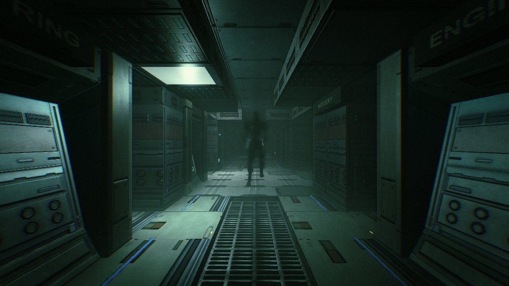
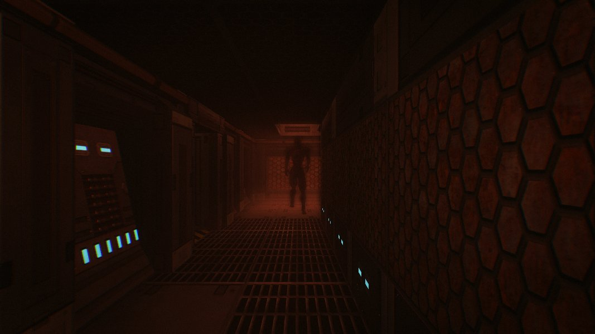
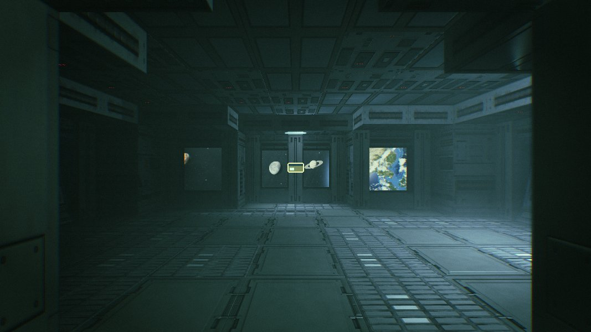
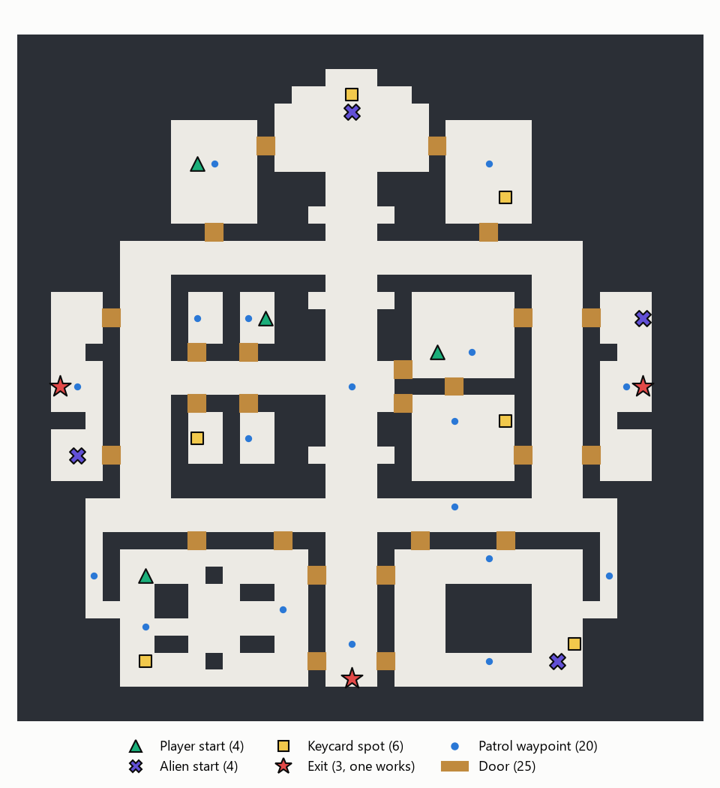
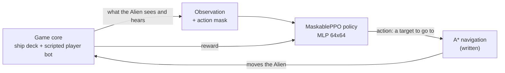
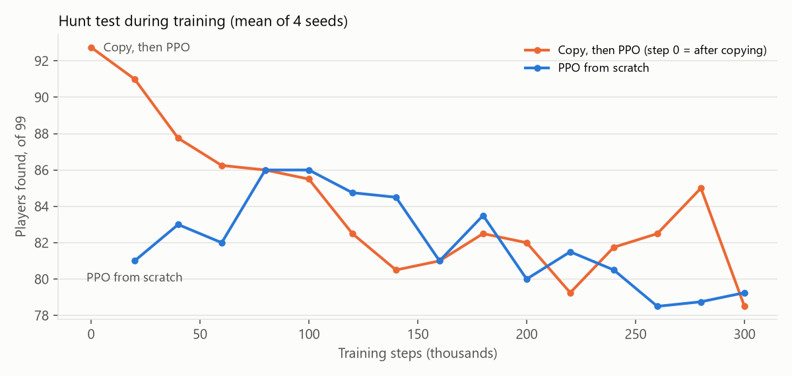
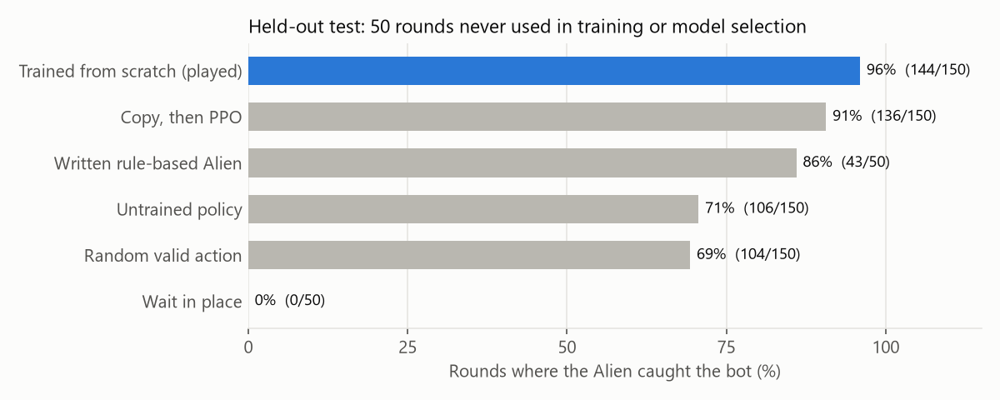

# Alien Survival RL

A first-person horror game in which a reinforcement learning Alien hunts the player across a spaceship.
The player has to find a keycard and escape through the one working exit. The Alien was trained from scratch
with MaskablePPO and knows only what it can see and hear.



| | |
|---|---|
|  |  |

## The game

- The ship is a 40x40 grid with 25 doors. Each round deals one of 4 player starts, one of 4 Alien starts,
  one of 6 keycard spots and one of 3 exits that works. The player is not told which exit works.
- The player wins by picking up the keycard and leaving through the working exit. The Alien wins by catching the player.
  There is no time limit.
- The Alien senses the player only by **sight** (a view cone blocked by walls) and **hearing** (footsteps carry
  6 cells walking and 16 running, and opening a door carries 8). Hidden player positions, the keycard and the working exit are never in its input.
- The game logic is a 2D core with no graphics. The first-person view draws 3D surfaces built from the 2D deck, so
  training runs on the same rules people play.



## How the Alien learns

The policy picks *where to go* every 0.5 seconds; a written A* planner walks it there. Learning to walk the
corridors step by step would take millions of steps more and teach nothing about hunting.



**Observation** (what the Alien knows)

1. Its own position and heading
2. Whether it sees the player now, and in which direction
3. Where it last saw the player
4. Which zone the last noise came from
5. How long ago each of the 20 patrol points was checked
6. Which actions are allowed right now (the action mask)

**Actions**

1. Go to one of 20 patrol points
2. Chase the player it can see
3. Investigate where it last saw the player
4. Investigate the zone a noise came from
5. Wait

MaskablePPO gives zero probability to actions that make no sense at that moment, such as chasing a player it cannot see.

**Reward**

| Event | Reward |
|---|---|
| Catches the player | +10 |
| The player escapes | -10 |
| First sight of the player in a round | +0.2 (once) |
| Reaches a patrol point nobody has checked for 60 s | +0.1 |

**Training settings**

| Setting | Value |
|---|---|
| Algorithm, network | MaskablePPO (sb3-contrib), MLP 64x64 |
| Learning rate | 0.0001 |
| Gamma, GAE lambda | 0.995, 0.95 |
| n_steps, batch size, epochs | 256, 64, 10 |
| Clip range, entropy coefficient | 0.2, 0.01 |
| Steps, seeds | 300,000 per run, 4 seeds |

## Training and evaluation

- **Opponents.** The Alien trains against scripted player bots: runners, explorers that back away when they see the
  Alien, and players that loop around walls.
- **Splits.** Rounds are split into 200 for training, 30 for validation and 50 for testing. The test rounds were
  used once, at the very end.
- **Two setups**, 4 seeds each:
  - PPO from scratch, learning from reward alone (the Alien people play against)
  - a comparison that first copies a written rule-based Alien (12,000 decisions of behavior cloning), then trains with PPO
- **Model choice.** Every 20,000 steps the policy is scored on the validation rounds and on a separate hunt test.
  `best.zip` is the checkpoint with the best score, measured on seeds that never appear in the reported results.
- **Hunt test.** Measures searching apart from the training bots, with three kinds of hidden player:
  - one who makes noise (32 cases)
  - one who stands silent (32 cases)
  - one hidden at a station somewhere on the ship (35 cases)

## Results

### Hunt test

Mean of 4 seeds; higher is better.

| Alien | Noisy (of 32) | Silent (of 32) | Hidden (of 35) | Noises followed |
|---|---|---|---|---|
| Untrained policy | 27.0 | 14.0 | 20.0 | 32% |
| **PPO from scratch, best** | **30.5** | **28.0** | **27.25** | **95%** |
| PPO from scratch, last | 29.25 | 24.25 | 26.75 | 88% |
| Copy of written Alien, before PPO | 31.75 | 32.0 | 32.5 | 85% |
| Copy, then PPO, best | 30.0 | 29.0 | 29.5 | 89% |
| Written rule-based Alien | 32 | 32 | 33 | 86% |



### Held-out test

On the 50 test rounds, the Alien trained from scratch caught the bot more often than every other Alien,
including the written one.



### Findings

- **Reward alone taught the Alien to hunt.**
  - It followed 95% of the noises it heard, against 32% before training.
  - It found a silent player 28 times out of 32, against 14.
  - It caught the bot in 96% of the held-out test rounds.
- **Copying the written Alien helps with searching.** That setup found hidden players more often (32.5 against
  27.25 of 35), because the reward comes from catching bots that move and make noise. Hiding is rarely rewarded.
- **Training longer made both setups worse.** The last checkpoint scored below the best one in every setup, so the
  checkpoint has to be chosen on validation. The best checkpoints came at 60,000 to 100,000 steps from
  scratch, and at 20,000 to 40,000 steps after copying.
- **Limitations:**
  - There is a single map, and new seeds deal new rounds on that same map.
  - The results are measured against scripted bots, not people.
  - Much of the Alien's skill comes from the written navigation and perception, not from learning.

## Setup

Windows x64 with [Git](https://git-scm.com/download/win) and [Python 3.12.5](https://www.python.org/downloads/release/python-3125/) exactly, because the trained Alien loads only on the versions it was trained with.

```powershell
git clone https://github.com/sorravit-te/RL_Alien_Survival.git
cd RL_Alien_Survival
powershell -ExecutionPolicy Bypass -File tools\bootstrap.ps1
```

Clone into a short path such as `C:\RL_Alien_Survival`: a deep folder runs into Windows' 260-character path limit during the install. The script makes `.venv`, installs the locked packages (about 1 GB) and downloads the free sounds and the mood. If `py -3.12` finds another 3.12, add `-Python <path to python.exe 3.12.5>`.

The ship's textures come from a purchased pack that cannot be shared here, and the game does not start without them. Owners of the pack put it in `assets/stradex/` before running the script; anyone given the baked textures puts `ship_textures.npz` and `ship_textures.json` in `assets/stradex/prepared/`.

## Play

Run from the repo root in PowerShell. The trained Alien is kept in `trained/`.

Against the trained Alien:

```powershell
.venv\Scripts\python.exe -B -m app.play --controller rl --run-dir trained/ship_deck_full_v3_scratch_s3/run --checkpoint trained/ship_deck_full_v3_scratch_s3/run/checkpoints/best.zip --sampling-seed 310003 --scenario-seed 310002 --fps-limit 60
```

Against the scripted Alien, or alone on the ship:

```powershell
.venv\Scripts\python.exe -B -m app.play --scenario ship_deck_v1 --scenario-seed 1 --fps-limit 60
.venv\Scripts\python.exe -B -m app.play --scenario ship_deck_v1 --scenario-seed 1 --fps-limit 60 --no-alien
```

- The game opens paused. Press N for a new round, since a command's seeds always deal the same first round. R replays the last round exactly, Esc pauses, and Q quits from the pause menu.
- WASD to move, Shift to run, E to interact, the mouse to look and the arrow keys to turn.
- `--windowed` stays in a window, `--fov` sets the view from 60 to 120 degrees (default 100), and `--scenario-seed <n>` picks a round.
- To record every round, add `--record-dir experiments/human_dev_<name>` to the trained Alien command. Review it with `.venv\Scripts\python.exe -m tools.review_recording experiments/human_dev_<name>`.
- In VS Code, Terminal > Run Task > "Alien RL: Play against trained Alien" runs the first command.

## Project layout

| Folder | Contents |
|---|---|
| `game/` | The 2D game core: map, movement, doors, sight, hearing and the Alien's memory. No graphics. |
| `ai/` | A* navigation and the written rule-based Alien |
| `rl/` | Gymnasium environment, observations, actions, rewards, scripted player bots, training (`rl/train.py`) and evaluation |
| `app/` | The playable game: input, game loop, sound, loading the trained Alien |
| `renderers/` | The first-person ship renderer |
| `tools/` | Setup, the hunt test, asset bakes and recording review |
| `configs/` | Training configurations |
| `trained/` | The checkpoint people play against |
| `tests/` | pytest suite |

## Assets

[Stradex - Sci-Fi Tech Hall Texture Pack](https://stradex.itch.io/scifi-tech-hall-texture-pack)

Earth and Moon imagery: NASA Earth Observatory and NASA's Scientific Visualization Studio. This project is not endorsed by NASA.

Alien: 3D Horror Game Monster on OpenGameArt (CC0). Sounds: CC0 recordings from Freesound and OpenGameArt, listed by the sound bake.

Lens dirt: zisongbr (CC0). Smoke: Kenney (CC0). Color grade: REEBOO Labs Color Grading LUT Pack.
